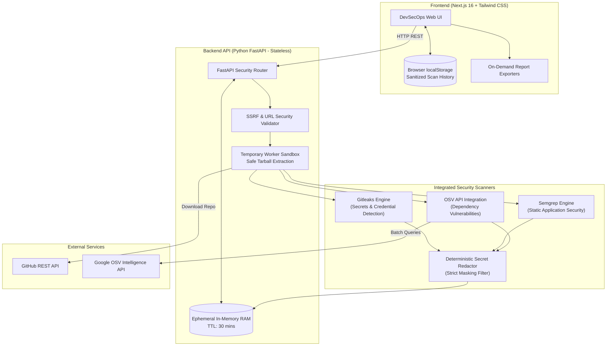

# RepoShield — GitHub Repository Security Analyzer

> **"Secure Your Code Before You Deploy."**

RepoShield is a production-oriented cybersecurity web application that audits authorized GitHub repositories for **exposed secrets**, **vulnerable third-party dependencies**, and **insecure coding patterns**.

---

## 🔒 Architectural Paradigm: Zero-Database Architecture

RepoShield strictly follows a zero-database design:
- **No Database Installed or Configured**: No PostgreSQL, MySQL, MongoDB, Firebase, Supabase, SQLite, Redis, or simulated DB services.
- **Ephemeral In-Memory Processing**: Active scans execute inside temporary worker sandboxes using isolated directories with automatic memory/file destruction upon completion (`SCAN_TTL_SECONDS`).
- **Browser Local Storage**: Historical scan summaries and pre-redacted findings reside exclusively within client-side browser `localStorage`.
- **Stateless Server Architecture**: Compatible with serverless, containerized, and horizontal autoscaling environments.

---

## 🏛️ System Architecture



---

## ⚡ Core Features

1. **Repository Security Scanner**:
   - Validates public GitHub URLs with strict SSRF defense.
   - Fetches repository metadata, branch hierarchy, commit references, and language breakdown.
   - Real-time animated progress stepper and live streaming execution terminal.

2. **Secret Detection (Gitleaks)**:
   - Integrates native Gitleaks CLI and built-in rules engine.
   - Detects AWS keys, GitHub personal access tokens, Slack tokens, Stripe live keys, OpenAI credentials, and private RSA/SSH keys.
   - **Systematic Redaction**: Every matched credential is systematically masked (`AKIA***REDACTED***`). Raw secrets are never stored, returned in APIs, or logged.

3. **Dependency Vulnerability Intelligence (OSV API)**:
   - Detects and parses `package.json`, `package-lock.json`, `requirements.txt`, `Pipfile`, and `poetry.lock`.
   - Queries the real Google Open Source Vulnerabilities (OSV) API in batches.
   - Retrieves real CVE IDs, GHSA IDs, CVSS v3 vectors/scores, affected version ranges, and fixed upgrade targets.
   - Carefully distinguishes unknown severity from low severity.

4. **Static Application Security Testing (Semgrep SAST)**:
   - Analyzes Python, JavaScript, and TypeScript source files.
   - Detects Command Injection (`shell=True`, `child_process.exec`), SQL Injection (f-string interpolation), Insecure Deserialization (`pickle`, unsafe YAML), Dangerous APIs (`eval`, `dangerouslySetInnerHTML`), and permissive CORS policies.
   - Zero execution of untrusted repository code.

5. **Security Dashboard & Local History**:
   - Executive Risk Index (0–100) calculated via transparent deterministic weighting.
   - Interactive severity and category charts powered by Recharts.
   - Vulnerability trend graphs across previous scans stored in browser `localStorage`.
   - Clear history and single-scan deletion controls.

6. **Executive Audit Deliverables**:
   - Downloadable PDF reports generated on-demand via ReportLab.
   - Structured CSV exports for SIEM and spreadsheet analysis.
   - Full JSON datasets for DevSecOps pipeline automation.

---

## 🛠️ Technology Stack

| Layer | Technologies |
|---|---|
| **Frontend** | Next.js 16 (App Router), TypeScript, Tailwind CSS, Recharts, Lucide Icons |
| **Backend** | Python 3.12, FastAPI, Pydantic v2, Uvicorn, HTTPX, ReportLab |
| **Security Engines** | Gitleaks (CLI & Engine), Semgrep (CLI & AST rules), Google OSV API |
| **Storage** | Ephemeral In-Memory Store (`EphemeralMemoryStore`) + Browser `localStorage` (Zero DB) |
| **Deployment** | Vercel (Frontend), Render / Docker (Backend) |

---

## 🚀 Local Setup Instructions

### Prerequisites
- Node.js 18+ and npm
- Python 3.11+
- Git

### 1. Backend Setup

```bash
# Navigate to backend directory
cd backend

# Create and activate virtual environment
python -m venv .venv

# Windows:
.\.venv\Scripts\activate
# Linux/macOS:
# source .venv/bin/activate

# Install dependencies
pip install -r requirements.txt

# Run backend test suite
pytest tests

# Launch FastAPI development server (runs on port 8000)
uvicorn app.main:app --host 127.0.0.1 --port 8000 --reload
```

Backend API documentation is available at: `http://localhost:8000/docs`

### 2. Frontend Setup

```bash
# In a new terminal, navigate to frontend directory
cd frontend

# Install dependencies
npm install

# Run frontend development server (runs on port 3000)
npm run dev
```

Open `http://localhost:3000` in your browser.

---

## ⚙️ Environment Variables

### Backend (`backend/.env` or Render environment settings)

| Variable | Default | Description |
|---|---|---|
| `ENVIRONMENT` | `development` | Set to `production` in live deployments |
| `GITHUB_TOKEN` | `None` | Optional GitHub Personal Access Token to avoid anonymous IP rate limits |
| `MAX_SCAN_SIZE_MB` | `100` | Maximum allowable uncompressed repository archive size |
| `MAX_SCAN_TIMEOUT_SECONDS` | `180` | Maximum execution timeout per scan worker |
| `SCAN_TTL_SECONDS` | `1800` | Ephemeral in-memory scan retention in seconds (30 minutes) |

### Frontend (`frontend/.env.local` or Vercel environment settings)

| Variable | Default | Description |
|---|---|---|
| `NEXT_PUBLIC_API_URL` | `http://localhost:8000` | URL of the deployed FastAPI backend API |

---

## 🚢 Deployment Instructions

### Deploy Frontend to Vercel
1. Push this repository to GitHub.
2. Link the repository to [Vercel](https://vercel.com).
3. Set **Root Directory** to `frontend`.
4. Configure environment variable: `NEXT_PUBLIC_API_URL=https://your-backend.onrender.com`.
5. Deploy.

### Deploy Backend to Render
1. Create a **Web Service** on [Render](https://render.com).
2. Choose **Docker** or **Python** environment.
   - If using Python runtime:
     - Root Directory: `backend`
     - Build Command: `pip install -r requirements.txt`
     - Start Command: `uvicorn app.main:app --host 0.0.0.0 --port $PORT`
   - If using Docker runtime:
     - Root Directory: `backend`
     - Dockerfile Path: `Dockerfile`
3. Add environment variables: `ENVIRONMENT=production`, `GITHUB_TOKEN=(optional)`.

---

## 🛡️ Security Posture & Limitations

1. **SSRF Defense**: Target hostnames are strictly restricted to `github.com`. Requests to private IPs (`127.0.0.1`, `10.*`, `172.16.*`, `192.168.*`, `169.254.169.254`) and non-GitHub hosts are rejected.
2. **Zip-Slip & Path Traversal Defense**: All archive extractions verify target member paths against root directory boundaries before writing.
3. **Redaction Guarantee**: Any detected secret is systematically replaced with masked tokens prior to API serialization or report output.
4. **Untrusted Code Execution**: Source code is analyzed strictly via static AST and regex matching. Repository code is **never** executed.
5. **Rate Limits**: Anonymous GitHub API requests are limited to 60/hr. Supplying a read-only token in the Settings page expands this to 5,000/hr.
