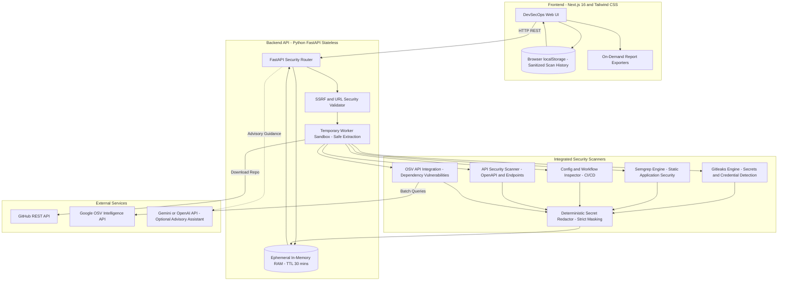

# RepoShield — GitHub Repository Security Analyzer

<p align="center">
  
</p>

<p align="center">
  <strong>"Secure Your Code Before You Deploy."</strong><br>
  Enterprise-grade, zero-database DevSecOps platform for scanning authorized GitHub repositories for exposed secrets, dependency vulnerabilities, supply chain risks, and static code security flaws.
</p>

<p align="center">
  <a href="https://github.com/mirarsalan-dev/RepoShield/blob/main/LICENSE.md"></a>
  <a href="https://www.python.org/downloads/"></a>
  <a href="https://nextjs.org/"></a>
  <a href="https://fastapi.tiangolo.com/"></a>
  <a href="https://tailwindcss.com/"></a>
  
</p>

---

## 🔒 Architectural Paradigm: Zero-Database Architecture

RepoShield operates under a strict **Zero-Database Design**:
* **No Database Installed or Configured**: No PostgreSQL, MySQL, MongoDB, Redis, SQLite, Firebase, Supabase, or simulated database services.
* **Ephemeral In-Memory Processing**: Active scans execute inside temporary worker sandboxes using isolated directories with automatic memory and file destruction upon completion (`SCAN_TTL_SECONDS`).
* **Browser Local Storage**: Historical audit summaries and pre-redacted findings reside exclusively within client-side browser `localStorage`.
* **Stateless Server Architecture**: Highly resilient, horizontally scalable, and natively compatible with serverless or containerized cloud platforms.

---

## 🏛️ System Architecture



---

## ⚡ Key Modules & Capabilities

### 1. Multi-Engine Security Scanner
* **Secret Detection (Gitleaks Engine)**: Scans source files and commit references for API keys, AWS credentials, GitHub tokens, Slack tokens, Stripe keys, and private SSH keys with systematic redaction (`AKIA***REDACTED***`).
* **Dependency Vulnerability Intelligence (OSV)**: Inspects `package.json`, `package-lock.json`, `requirements.txt`, `Pipfile`, and `poetry.lock`. Queries the Google OSV API in batches for accurate CVEs, GHSA IDs, and CVSS v3 metrics.
* **Static Application Security Testing (Semgrep SAST)**: AST-driven detection for Command Injection (`shell=True`), SQL Injection, Insecure Deserialization (`pickle`), XSS (`dangerouslySetInnerHTML`), and permissive CORS policies.
* **API Security & Contract Scanner**: Audits OpenAPI / Swagger specifications and endpoints for missing authentication, unencrypted transmissions, and overly permissive endpoints.
* **Infrastructure as Code & CI/CD Guardrails**: Audits GitHub Actions workflows for overly permissive `GITHUB_TOKEN` scopes (`write-all`), unpinned third-party actions, and script injections.
* **Container Security Inspector**: Audits `Dockerfile` configs for root execution, untagged base images, package manager cache retention, and sensitive credential exposure.

### 2. Interactive Review Workbench & Triage
* Search, filter, and group findings by severity, category, detector, and status.
* Live finding triage with status tracking (`OPEN`, `ACKNOWLEDGED`, `IN_REVIEW`, `RESOLVED`, `FALSE_POSITIVE`).
* Side-by-side vulnerable code snippet viewing with syntax highlighting and line indicators.

### 3. In-Browser Fix Sandbox & Automated Re-Scan Validation
* Test code remediation patches directly within an in-browser sandbox.
* Automatic diff calculation and live re-scan execution to verify whether a patch truly eliminates the vulnerability.

### 4. Supply Chain Intelligence & SBOM / OpenVEX
* Generates industry-standard **CycloneDX 1.5 JSON SBOMs** and **SPDX** software bills of materials.
* Provides **OpenVEX 0.2.0** justification records (`not_affected`, `vulnerable_code_not_present`, `vulnerable_code_cannot_be_controlled_by_adversary`).

### 5. Exploitability & Reachability Analysis
* Correlates findings with real-world **EPSS (Exploit Prediction Scoring System)** probabilities and **CISA Known Exploited Vulnerabilities (KEV)** catalog records.
* Performs call-graph AST reachability analysis to distinguish reachable dependencies from unused imports.

### 6. Attack Path Visualization & Compliance Mapping
* Visual graph mapping chained attack vectors from external network exposure to privilege escalation.
* Framework-level compliance checklists mapping findings to **OWASP Top 10 (2021)**, **SOC 2 Type II**, **ISO 27001:2022**, and **PCI-DSS v4.0**.

### 7. AI Security Assistant (Optional & Advisory)
* Optional integration with **Google Gemini** or **OpenAI** for plain-language vulnerability explanations and patch review.
* Strictly pre-redacted: snippets are sanitized before submission. Deterministic rule-based guidance is used when no key is provided.

### 8. Executive Deliverables & Export Center
* **Executive PDF Audit Report**: Generated on-demand via ReportLab with risk scores, breakdowns, and audit timelines.
* **SARIF 2.1.0 Export**: Full compatibility with GitHub Advanced Security and IDE security extensions.
* **CSV & JSON**: Structured data exports for SIEMs and security operations dashboards.

### 9. CLI & Pre-Commit Hook Integration
* Run scans locally using the native CLI:
  ```bash
  python -m app.cli scan . --fail-on high
  python -m app.cli secrets .
  ```
* Integrated pre-commit hook support via `.pre-commit-hooks.yaml`.

---

## 🛠️ Technology Stack

| Component | Technologies |
|---|---|
| **Frontend** | Next.js 16 (App Router), TypeScript, Tailwind CSS v4, Framer Motion, Recharts, Lucide Icons |
| **Backend** | Python 3.12, FastAPI, Pydantic v2, Uvicorn, HTTPX, ReportLab |
| **Security Engines** | Gitleaks Engine, Semgrep Engine, Google OSV API, AST Parsers |
| **Storage** | Ephemeral RAM (`EphemeralMemoryStore`) + Browser `localStorage` (Zero DB) |
| **Tooling** | Pre-commit Hooks, Pytest, Pytest-Asyncio, ESLint, Git |

---

## 🚀 Quick Start Guide

### Option A: One-Click Development Launcher (Windows PowerShell)

Run the included launcher to automatically verify environments and start both services:

```powershell
.\run_dev.ps1
```

* Frontend: `http://localhost:3000`
* Backend API & Swagger Docs: `http://127.0.0.1:8000/docs`

---

### Option B: Manual Step-by-Step Setup

#### 1. Backend Setup

```bash
# Navigate to backend directory
cd backend

# Create and activate Python virtual environment
python -m venv .venv

# Windows:
.\.venv\Scripts\activate
# macOS/Linux:
# source .venv/bin/activate

# Install dependencies
pip install -r requirements.txt

# Run automated test suite
pytest

# Launch FastAPI development server (runs on port 8000)
uvicorn app.main:app --host 127.0.0.1 --port 8000 --reload
```

API documentation is accessible at `http://localhost:8000/docs`.

#### 2. Frontend Setup

```bash
# In a separate terminal, navigate to frontend directory
cd frontend

# Install Node dependencies
npm install

# Start Next.js development server (runs on port 3000)
npm run dev
```

Open `http://localhost:3000` in your browser.

---

## ⚙️ Environment Variables

Copy `.env.example` to `.env` to configure optional integrations and overrides:

```bash
cp .env.example .env
```

| Variable | Default | Description |
|---|---|---|
| `ENVIRONMENT` | `development` | Deployment environment (`development` \| `production`) |
| `GITHUB_TOKEN` | `None` | Optional GitHub Personal Access Token (boosts rate limit from 60/hr to 5,000/hr) |
| `GEMINI_API_KEY` | `None` | Optional Google Gemini API key for AI Security Assistant |
| `OPENAI_API_KEY` | `None` | Optional OpenAI API key for AI Security Assistant |
| `NEXT_PUBLIC_API_URL` | `http://localhost:8000` | Target URL of the backend FastAPI service |
| `MAX_SCAN_SIZE_MB` | `100` | Maximum uncompressed repository archive size in megabytes |
| `MAX_FILE_SIZE_BYTES` | `10485760` | Maximum individual file size limit (10MB default) |
| `MAX_SCAN_TIMEOUT_SECONDS` | `180` | Maximum scanning execution timeout per worker |
| `SCAN_TTL_SECONDS` | `1800` | Ephemeral RAM scan retention window in seconds (30 minutes) |

---

## ⚓ Pre-Commit Hook Integration

Add RepoShield to your repository's `.pre-commit-config.yaml` to block credential leaks and vulnerabilities before commits are made:

```yaml
repos:
  - repo: https://github.com/mirarsalan-dev/RepoShield
    rev: main
    hooks:
      - id: reposhield-secrets
      - id: reposhield-scan
        args: ["--fail-on", "high"]
```

---

## 🛡️ Security Posture & Safeguards

1. **SSRF Defense**: Target hostnames are strictly restricted to legitimate `github.com` repositories. Requests targeting localhost, private network ranges (`127.0.0.1`, `10.*`, `172.16.*`, `192.168.*`), cloud metadata endpoints (`169.254.169.254`), or arbitrary hosts are blocked.
2. **Zip-Slip & Path Traversal Prevention**: Archive extraction validates that every member path resolves strictly within the isolated temporary sandbox boundary.
3. **Deterministic Secret Redaction**: Detected API tokens and credentials are masked (`ghp_***REDACTED***`) immediately upon discovery. Unredacted secrets are never serialized into API responses or persisted to storage.
4. **Zero Untrusted Code Execution**: All scanning is performed strictly through static AST parsing, pattern evaluation, and metadata queries. Repository code is **never** executed.
5. **Rate-Limit Handling**: Unauthenticated GitHub API calls are limited to 60/hr. Supplying a read-only token in `.env` or in Settings expands this to 5,000 requests/hr.

---

## 🚢 Production Deployment

### Frontend (Vercel)
1. Import repository into [Vercel](https://vercel.com).
2. Set **Root Directory** to `frontend`.
3. Configure environment variable: `NEXT_PUBLIC_API_URL=https://your-backend-service.com`.
4. Deploy.

### Backend (Render / Docker)
1. Create a new **Web Service** on [Render](https://render.com).
2. Select repository with **Root Directory** set to `backend`.
3. Build Command: `pip install -r requirements.txt`.
4. Start Command: `uvicorn app.main:app --host 0.0.0.0 --port $PORT`.
5. Configure environment variables (`ENVIRONMENT=production`, optional `GITHUB_TOKEN`).
6. Deploy.

---

## 📄 License

This project is licensed under the [MIT License](LICENSE.md).

---

## 👤 Author

Developed by **[Arsalan Mir](https://github.com/mirarsalan-dev)**.
Contributions, issues, and feature suggestions are welcome!
